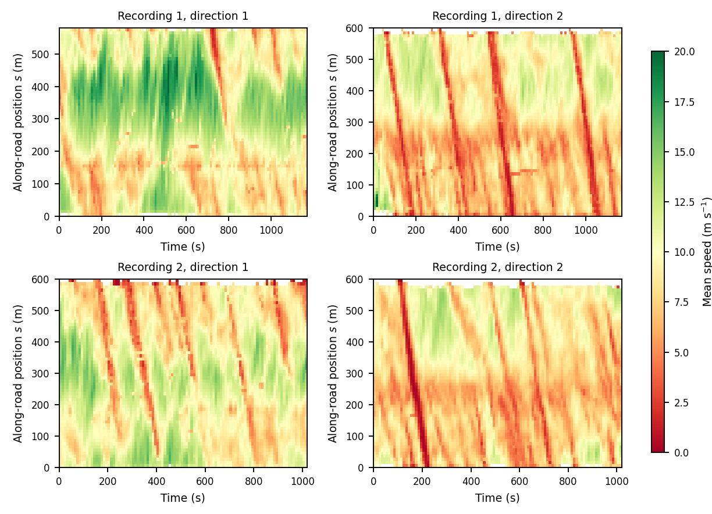
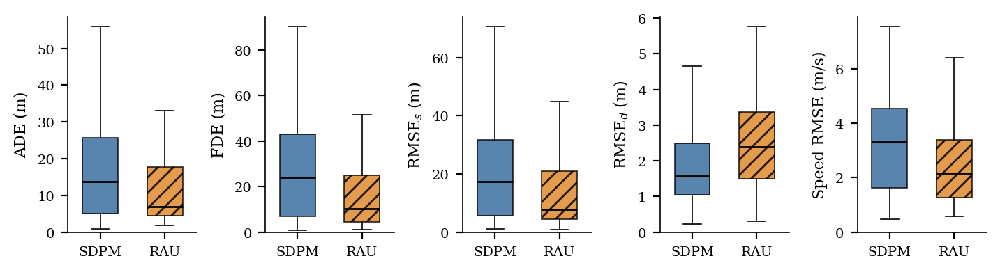

<h1 align="center">Weak-lane Freeway Driving: A Naturalistic Trajectory Dataset and Evaluation of Interaction Models</h1>

<p align="center">
  <a href="https://github.com/pebeigi/AD-in-Weak-Lane-Traffic/actions/workflows/reproducibility.yml"></a>
  <a href="https://www.sciencedirect.com/journal/transportation-research-part-c-emerging-technologies"></a>
  <a href="https://www.python.org/"></a>
  <a href="LICENSE"></a>
  <a href="data/LICENSE"></a>
</p>

This repository holds the data, code, and outputs for the paper:

> Khoueiry, M.S., Beigi, P., Hamdar, S.H. *Toward Autonomous Driving in Weak-Lane Freeway Traffic: A Naturalistic Trajectory Dataset and Comparative Evaluation of Interaction Models* Manuscript submitted to *Transportation Research Part C: Emerging Technologies*.

It contains:

1. **The processed trajectory dataset.** 3,006,441 positions at 0.1 s in 7,486 trajectories, from two drone recordings of a congested, two-direction freeway section with ramps and roadside parking.
2. **The model comparison.** Two two-dimensional interaction models are calibrated and evaluated on the same 100 light-vehicle trajectories, with an identical loss, optimizer budget, neighbor set, and held-out simulation:
   - an adapted self-driven particle model (**SDPM**), after Kanagaraj and Treiber (2018);
   - a risk-aware utility model (**RAU**), in the line of the sequential risk-taking models of Hamdar et al. (2008, 2015).
3. **The analysis pipeline.** Every number, table, and data-driven figure in the paper is generated from the files in `outputs/`.

## Results at a glance

### Traffic conditions in the two recordings

The time--space diagrams show mean speed along the road for both directions in
both recordings. The recurring diagonal low-speed bands (red) are upstream-
moving congestion waves; direction 2 is generally slower than direction 1.



### Held-out model comparison

The box plots compare the two models on the same 100 held-out trajectories.
RAU has lower longitudinal, final-displacement, and speed errors, while SDPM
has lower lateral error. These plots summarize distributions; paired tests and
effect sizes are reported in `outputs/statistics/paired_tests.csv`.



## Repository layout

```
.
├── data/
│   ├── Final_Lebanon_Data.xz      compressed trajectory CSV
│   ├── README.md                  data dictionary and provenance
│   ├── CITATION.cff               dataset-specific citation metadata
│   └── LICENSE                    data license (CC BY 4.0)
├── sdpm_calibration.py            SDPM simulator, loss, and genetic search
├── sdpm_dynamics.py               SDPM acceleration and lateral rules
├── rau_calibration.py             RAU simulator, loss, and genetic search
├── highway_geometry.py            stream corridors, centerline frame, corridor probability
├── trajectory_frames.py           shared frame construction with vehicle dimensions
├── comparison_exports.py          file-name helpers imported by the model files
├── analysis/                      experiment pipeline, statistics, figures, tables, tests
├── outputs/
│   ├── cohorts/                   the frozen 100-trajectory cohort
│   ├── geometry/                  fitted corridor polylines (one per recording and direction)
│   ├── results/                   per-trajectory calibration and evaluation results
│   ├── statistics/                paired tests, diagnostics, dataset summaries, environment
│   ├── tables/                    intermediate tables
│   ├── figures/                   all data-driven figures (PDF and PNG)
│   └── rerun_calibration.log      log of the final calibration run
├── Makefile                       data, test, analysis, cohort, and calibration targets
├── requirements.txt               supported dependency ranges
├── requirements-lock.txt          exact published environment
├── CITATION.cff
└── LICENSE                        code license (MIT)
```

Model modules and public functions use the paper's `SDPM` and `RAU`
terminology. The released dataset retains the historical column name
`lane_kf`, documented as a travel-direction code in `data/README.md`.

## Requirements

Python 3.9 or later with numpy, pandas, and matplotlib. Use
`requirements.txt` for supported dependency ranges or `requirements-lock.txt`
to recreate the exact published Python package environment. SciPy is not
needed: the bootstrap, Wilcoxon signed-rank test, Holm adjustment, and Spearman
correlation are implemented in `analysis/`. The published results were
produced with Python 3.9.6, numpy 2.0.2, pandas 2.3.3, and matplotlib 3.9.4
(`outputs/statistics/environment.txt`).

## Reproducing the results

```bash
python -m pip install -r requirements-lock.txt
make verify-data # checks the compressed and uncompressed SHA-256 digests
make data       # decompresses data/Final_Lebanon_Data.xz to ./Final_Lebanon_Data.csv
make test       # determinism and model checks
make analysis   # all statistics, figures, tables, and LaTeX macros from the stored calibration results
```

On Windows PowerShell, where `make` may not be installed, use:

```powershell
python -m pip install -r requirements-lock.txt
.\scripts\reproduce.ps1 -Target Data
.\scripts\reproduce.ps1 -Target Test
.\scripts\reproduce.ps1 -Target Analysis
```

The uncompressed trajectory file (294,731,898 bytes) exceeds GitHub's 100 MB
file limit, so the repository stores it as the 65,586,856-byte XZ archive
`data/Final_Lebanon_Data.xz`. The archive SHA-256 is
`0a949b5c9d93f4d4ee95a3b27fdd36e1dadd08506c5cb7461c4a6043f206ddbf`; the
uncompressed CSV SHA-256 is
`5807e3122a15b89dcf19e2ec13fa8d8126466267df711361801edfc5cbf9268a`.
The verification command checks both values, and the analysis code reads the
CSV but never modifies it. See [`data/README.md`](data/README.md) for the data
dictionary, missing-value counts, provenance, and scope limitations.

`make analysis` reads the stored calibration results in `outputs/results/` and regenerates every downstream statistic, table, and data-driven figure in `outputs/`. It also writes the manuscript's LaTeX tables and number macros to `paper/`, which is not tracked. On a laptop it takes several minutes; the first run also builds a stream index in `outputs/cache/`.

### Rerunning the calibration

The calibration is expensive: about 22 CPU-hours, or about 3 hours with 8 worker processes.

```bash
make calibrate
```

This calibrates both models on the pilot split (24 trajectories, search seeds 20261004 + i) and then on the reserve and main splits (76 trajectories, search seeds 20261004 + 5000 + i). It overwrites `outputs/results/pilot_paired_results.csv` and `outputs/results/extended_paired_results.csv`. Run `make analysis` afterwards. Search and execution noise are seeded deterministically (see below), so a rerun with the same package versions should reproduce the stored results.

### Redrawing the cohort

The cohort in `outputs/cohorts/paired_cohort.csv` was drawn once, before any model was scored, and has not been edited since. Both steps that write it refuse to overwrite an existing cohort. To redraw it from scratch, delete that file and run `make cohort`. This performs two steps:

1. `analysis.paired_pipeline prepare` fits the corridors and draws 6 pilot and 6 reserve trajectories per stream with `random.Random(20261004)`.
2. `analysis.draw_main_cohort` draws up to 13 main trajectories per stream with `random.Random(20261021)`.

Both steps use the same eligibility rule:
- light vehicles (class 2);
- at least 150 samples;
- a path of at least 40 m;
- median speed between 2 and 25 m/s;
- net heading within 25° of the stream heading.

The resulting cohort has 25 trajectories per stream: 24 pilot, 24 reserve, and 52 main.

The optimizer budget (population 20, 40 generations) was fixed beforehand by the `time` and `stability` stages of `analysis/paired_pipeline.py`. Their outputs are `outputs/statistics/optimizer_stability.csv`, `optimizer_history.csv`, and `frozen_budget.json`. Those stages ran before the SDPM overlap-rule correction described below, and the budget was not re-selected afterwards. Rerunning them would overwrite the stored budget evidence.

## Experimental protocol (summary)

- **Data used.** Both models use the 0.1 s positions resampled to 0.5 s, with five 0.1 s substeps per sample.
- **Neighbors.** Each vehicle sees its four nearest neighbors. Neighbors are replayed from the log rather than simulated.
- **Calibration and holdout.** Each trajectory is split 70/30. Parameters are fitted on the first 70%. The last 30% is simulated from the observed state at the boundary and scored.
- **Loss.** SSE_pos/SS_pos + 0.5 · SSE_u/SS_u, computed over step displacements and velocity components. Both models are fitted by a genetic algorithm with population 20, 40 generations, tournament size 3, four elites, mutation rate 0.2, and an early stop when the training displacement error falls below 2 m.
- **Execution noise.** Seeded per trajectory and model by the first four bytes of SHA-256("20261004|run|direction|id|model") (`analysis/trajectory_seed.py`). Repeated evaluation of one parameter vector on one trajectory therefore reproduces the stored score exactly (`outputs/statistics/replay_check.csv`).
- **Paired statistics.** Median paired difference (RAU − SDPM) with a 5,000-draw percentile bootstrap interval, plus the Wilcoxon signed-rank test with rank-biserial correlation and Holm adjustment over five metrics (`analysis/paired_statistics.py`).

## Where each paper item comes from

| Paper item | Script | Output |
|---|---|---|
| Table 1 (dimensions by recording) | `analysis/recording_dimension_audit.py` | `paper/tables/tab_dims.tex` |
| Table 2 (dataset by stream), Figs. 4, 5, 6, 8 | `analysis/dataset_figures.py` | `dataset_tracks`, `dataset_timespace`, `dataset_distributions`, `dataset_snapshot` |
| Fig. 7 (corridor) | `analysis/plot_corridors.py` | `corridor_run1_dir1` |
| Fig. 9 (stagger and band sensitivity) | `analysis/dataset_and_behavior.py`, `analysis/threshold_sensitivity.py`, `analysis/generate_paper_figures.py` | `stagger_and_threshold` |
| Table 3 (lateral organization) | `analysis/generate_tables.py` | `paper/tables/tab_data.tex` |
| Table 6 and Fig. 10 (paired held-out errors) | `analysis/paired_statistics.py`, `analysis/generate_tables.py`, `analysis/generate_paper_figures.py` | `tab_paired.tex`, `final_model_comparison` |
| Table 7 and Fig. 11 (error by horizon) | `analysis/model_diagnostics.py` | `tab_horizon.tex`, `error_by_horizon` |
| Table 8 (by stream) | `analysis/generate_tables.py` | `tab_stream.tex` |
| Table 9 (RAU knockout), Table 10 (parameter reuse across recordings) | `analysis/transfer_and_sensitivity.py` | `tab_knockout.tex`, `tab_transfer.tex` |
| Table 5 (parameters and bounds) | `analysis/model_diagnostics.py`, `analysis/generate_tables.py` | `tab_params.tex` |
| Fig. 12 (differences and interaction descriptors) | `analysis/interaction_regime.py`, `analysis/generate_paper_figures.py` | `delta_and_regime` |
| Fig. 13 (representative cases) | `analysis/generate_paper_figures.py` | `representative_cases` |
| Section 7.7 (execution-noise replicates) | `analysis/model_diagnostics.py` | `noise_replicates.csv`, `noise_replicate_tests.csv` |
| Table 11 and Section 7.8 (results by recording) | `analysis/recording_dimension_audit.py` | `tab_byrec.tex`, `paired_tests_by_recording.csv`, `calibration_by_recording.csv` |

Figure and table outputs ending in `.tex` are written to `paper/tables/`; figures are written to `outputs/figures/`. Figures 1–3 (site photographs, processing workflow, annotated frame, and raw reference trajectories) and Table 4 are not produced by the code.


## Citation

Please cite the paper (see `CITATION.cff`). The collection and raw extraction are also described in:

> Khoueiry, M., Haque, M., Beigi, P., Talebpour, A., Hamdar, S.H. (2025). Non-Lane-Based Acceleration Behavior on a Freeway in Jounieh, Lebanon: From Aerial Trajectory Extraction to Model Calibration. Transportation Research Board 104th Annual Meeting, Washington, DC, Paper TRBAM-25-05607.

## Archival release

Release metadata are prepared in `.zenodo.json`. The first archival release
should be tagged `v1.0.0` and deposited in Zenodo. After Zenodo assigns the
record and version DOIs, add the DOI badge here, add the DOI to `CITATION.cff`,
and cite the dataset DOI rather than the mutable `main` branch. No DOI is
claimed in this repository until Zenodo has minted one.

## License

The code is released under the MIT License (`LICENSE`). The trajectory data in
`data/` are released separately under the Creative Commons Attribution 4.0
International License (`data/LICENSE`). The repository-level `CITATION.cff`
describes the research software and preferred paper citation; reuse of the
dataset remains governed by `data/LICENSE`.

## Contact

Michel S. Khoueiry, Department of Civil and Environmental Engineering, The George Washington University (mskhoueiry@gwu.edu).
